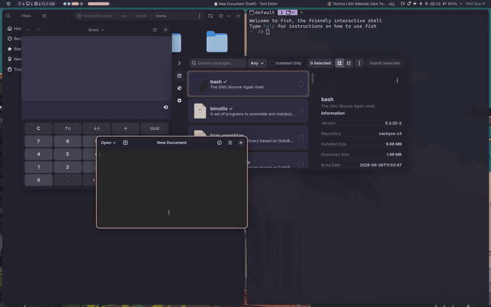

# niri-stash

Stash the floating windows on the current niri workspace by pushing them off to the screen sides.



(Recorded with `contrib/record-demo.sh`.)

## Install

```sh
# 1: Clone this repo.
git clone https://github.com/taminomara/niri-stash.git && cd niri-stash
# 2: Install binary.
cargo install --path .
# 3: Add systemd service for niri-stash (if not using systemd, ensure that
# `niri-stash daemon` runs in background).
cp contrib/niri-stash.service ~/.config/systemd/user/
systemctl --user daemon-reload
systemctl --user enable --now niri-stash.service
# 4: Add keybinds to spawn `niri-stash toggle` and `niri-stash unstash`.
cat contrib/keybinds.kdl >> ~/.config/niri/config.kdl
```

## Using it

- `Mod+S` stashes every floating window on the focused workspace, or restores them all if none is
  left to stash.
- `Mod+Shift+S` restores them all without ever stashing.
- `niri-stash stash|unstash|toggle` is the CLI interface.
- Alt-tab into a stashed window brings it back. Hovering or clicking a stashed window does nothing.
  Moving, resizing, or tiling it by hand marks it as unstashed.
- If `focus-follows-mouse` is off in your niri config, start the daemon with
  `niri-stash daemon --no-focus-follows-mouse`, then any focus change onto a stashed window
  brings it back.

## When something looks wrong

`journalctl --user -u niri-stash -t niri-stash -e` has both the daemon's log and the hotkey client's
errors. Every forget logs the window's original geometry so it can be restored by hand.

Exit codes: client `0` ok, `1` daemon unreachable, `2` the daemon reported an error (printed), `3` no
reply within 5 s, `64` usage. Daemon `69` niri unreachable, `75` niri's event
stream ended, `78` configuration error or another daemon owns the socket (not restarted).

## Licence

GPL-3.0-or-later (it links `niri-ipc`, which is GPL-3.0-or-later).
